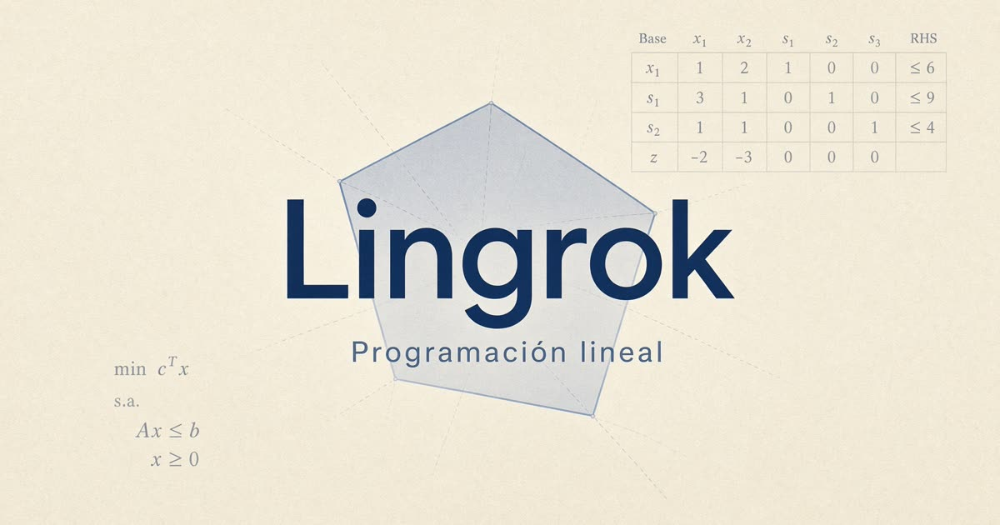

# Lingrok

Programación lineal para Investigación Operativa. La escribís como en LINGO, la resolvés en el celular y leés el simplex como en la hoja de la cátedra.



Hecha para practicar modelos, no para reemplazar un solver industrial. Los ejemplos son opcionales: el modelo en blanco es el punto de partida.

## Qué tiene

| | |
|---|---|
| **Editor** | Tabla de coeficientes o texto LINGO. Van y vuelven entre sí. |
| **Informe** | Estado, valor de z, holguras y precios duales. |
| **Sensibilidad** | Rangos del RHS y de los coeficientes del funcional. |
| **Simplex** | Cada iteración, con `cₖ`, `Cₖ`, `Xₖ`, `Bₖ` y la fila `z`. |
| **Gráfico** | Región factible cuando hay exactamente dos variables. |
| **Entera** | `@BIN` y `@GIN`, por branch and bound. |

La aritmética del tablero es exacta (fracciones). En pantalla podés ver decimal o fracción.

El tema arranca en el del sistema. Claro y oscuro están al lado del título.

## Un modelo

```
MAX = 4X1 + 3X2;

EST) 6X1 + 16X2 <= 48000;
SOL) 12X1 + 6X2 <= 42000;
PIN) 9X1 + 9X2 <= 36000;
```

El nombre antes del paréntesis es el de la fila (`EST`, `SOL`, `PIN`). `<=`, `>=` y `=` valen. `MAX` y `MIN` también, o `MAXIMIZE` / `MINIMIZE`.

Las holguras, los excesos y las artificiales aparecen solas en el simplex. No hace falta declararlas.

## Conjuntos

```
SETS:
    Productos / P1..P5 /: X, Costo, Demanda;
ENDSETS

DATA:
    Costo = 12 15 10 18 14;
    Demanda = 100 80 120 90 110;
ENDDATA

MIN = @SUM( Productos(i): Costo(i) * X(i) );

@FOR( Productos(i):
    X(i) <= Demanda(i)
);
@FOR( Productos(i):
    X(i) >= 0
);
```

`P1..P5` expande el conjunto. `@SUM` y `@FOR` arman el modelo plano que después ve el simplex.

## La tabla

- Las flechas, Enter y Tab saltan de celda en celda. En un nombre, izquierda y derecha mueven el cursor; al llegar al borde, pasan a la celda de al lado.
- El borde de cada columna se arrastra. Doble clic lo ajusta al texto.
- **Pantalla** la abre a pantalla completa. Escape o **Cerrar** la devuelve.
- **Tipo de todas** pone todas las variables en enteras o binarias de una vez. Después cada columna se cambia sola.
- El lado derecho de las restricciones es la columna **RHS**. En el simplex, **Bₖ** es el valor de la variable básica en ese paso: al principio coinciden, después del pivote no.

## Simplex

La tabla de cada paso queda así:

```
        cₖ   4    3    0    0    0
Cₖ  Xₖ  Bₖ  X1   X2   h1   h2   h3
4   X1  …   …    …    …    …    …
3   X2  …   …    …    …    …    …
    z   z   …    …    …    …    …
```

`Cₖ` es el coeficiente del funcional de la variable que está en la base (el mismo número de la fila `cₖ`). `Xₖ` es quién está en la base. `Bₖ` es cuánto vale. La fila `z` son los coeficientes del tablero en ese paso, y `z` el funcional.

Las columnas dicen si son variable de decisión, holgura, exceso o artificial. Se marca quién entra y quién sale.

## Enteras y binarias

```
@GIN(X1);
@BIN(P1);
```

Binaria fuerza cotas 0 y 1. El informe distingue óptimo continuo de óptimo entero.

## En el iPhone

Es una PWA. En Safari: Compartir → Agregar a inicio. Queda a pantalla completa. Los modelos se guardan en el aparato; no hace falta una cuenta.

## Correrlo

```bash
npm install
npm run dev
```

El dev server escucha en el puerto `8080`.

```bash
npm run typecheck
npm run build
```

## Stack

React, TypeScript, TanStack Router, Tailwind y Vite. El solver es propio: simplex de dos fases y branch and bound, sin llamar a un servicio externo.

## Autor

[Mateo Diaz](https://github.com/MateoDi9z)
